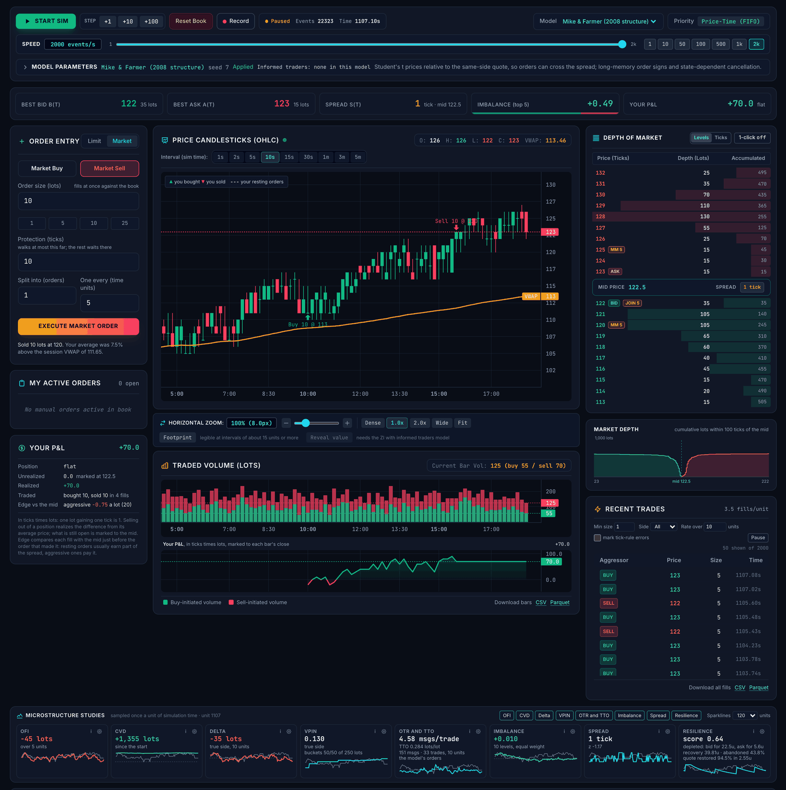
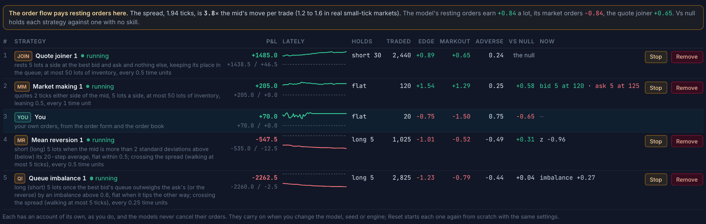
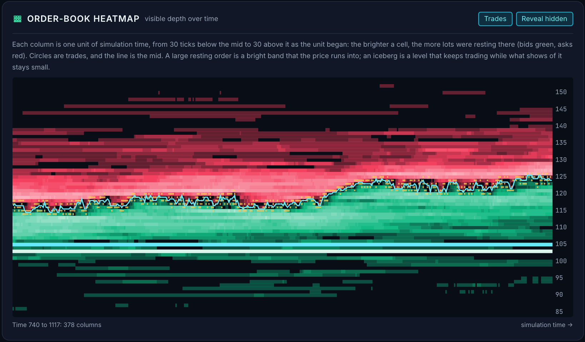
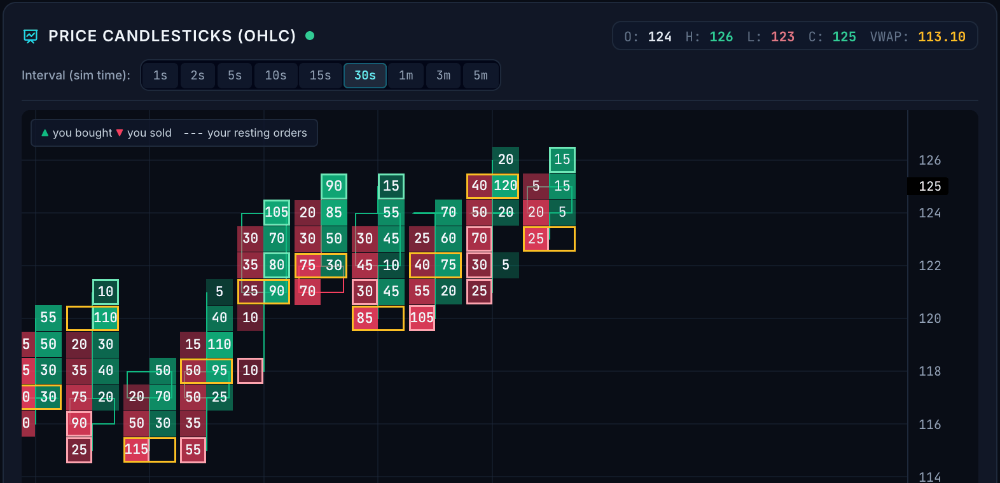
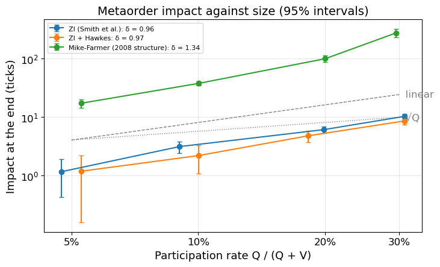
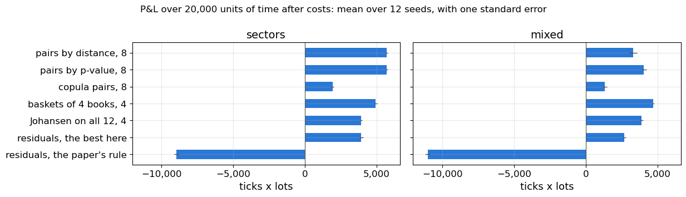
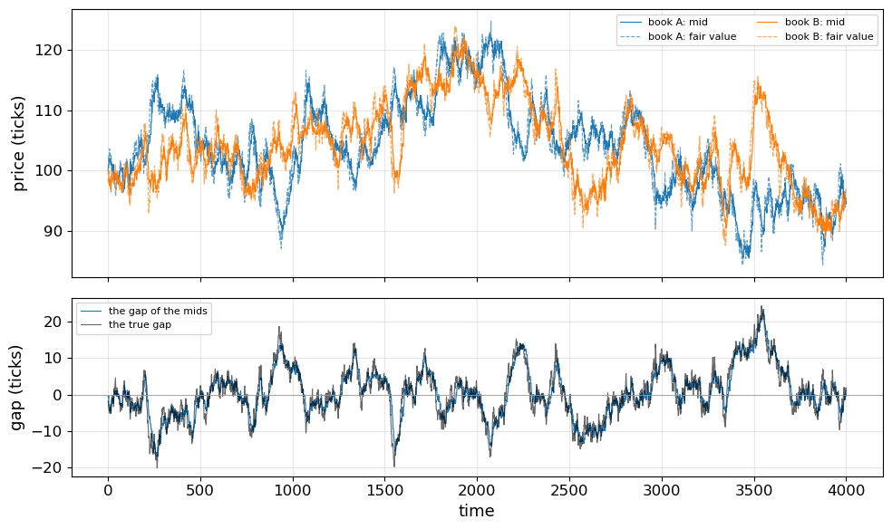
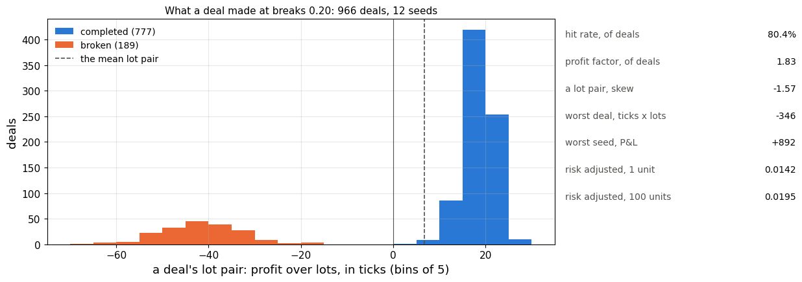
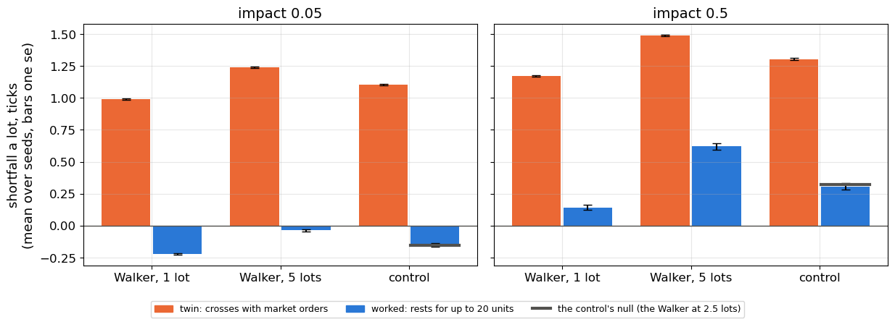

# Quant Trading Lab

Trading strategies, their execution and the market's microstructure, studied in simulated markets where the truth is known.

There is no price history to replay: a strategy's orders go into simulated order books, so it pays the spread and moves the price it trades at. Because the simulator knows the truth (each trade's real side, a hidden value, which books are really related), a claim can be checked against it. Notebooks 12 to 17 judge their results on seeds no setting was chosen on, and notebooks 16 to 18 write their predictions down before the run.

Quant Trading Lab (called Limit Order Book Simulation until November 2026) is a pure-Python library (the package is still `lob`), a web dashboard and eighteen notebooks. It began as an illustration of the concepts in [Gould et al. (2013), *Limit order books*](https://doi.org/10.1080/14697688.2013.803148) ([arXiv:1012.0349](https://arxiv.org/abs/1012.0349)). The code is educational -- it is a teaching tool, not a production trading system.



*The Trade view after about 1,100 time units: candles with fills marked, volume, ladder, depth, tape, your P&L and the studies band.*

## What is inside

- **The library** (`lob/`): an order book, matching engines and six simulation models, written for clarity over speed.
- **Strategies**: pairs, stat-arb over many books, cross-sectional long/short portfolios, and merger and index arbitrage, each tested where the truth is known.
- **Execution**: metaorder impact against a twin run, and resting orders in place of market orders.
- **Microstructure**: order flow imbalance, VPIN, trade signing, order-to-trade ratios and resilience, as live studies and as notebook measurements.
- **Nasdaq order books**: a converter reads them order by order, and [notebook 18](notebooks/18_real_books.ipynb) repeats notebook 14's measurements on five stocks on two days of 2019. The data is not in the repository.
- **The dashboard** (`app/`): five views, Trade, Analyze, Learn, Pairs and Stat-arb, with one simulation per browser session.
- **Notebooks**: six walk through the paper section by section, and twelve go on to the studies above.

## The dashboard

- Trade by hand against simulated order books and see your orders move the price.
- Run up to twelve strategies at once; a leaderboard ranks them by P&L.
- Record a session, play it back exactly, and try other strategies on the same market.
- Read microstructure signals live in a simulator that knows each trade's true side.
- Run pairs and stat-arb traders in markets whose true relations are known.



*The leaderboard ranks four strategies and you by P&L, with edge, markout and the result against a null with no skill; here two of them lose.*

<table>
<tr>
<td width="50%"><br><em>The order-book heatmap: resting depth over time with the mid and trades; the two bright bands are two orders placed in the session, one of them an iceberg, shown because Reveal hidden is on.</em></td>
<td width="50%"><br><em>The footprint: lots sold at the bid and bought at the ask at each price in each bar, busiest price outlined.</em></td>
</tr>
</table>

Start it with `make serve` and open <http://localhost:8000>. [docs/dashboard.md](docs/dashboard.md) lists everything it does.

## Results

Five figures from the notebooks, all from simulated markets. Each links to its notebook.



In [notebook 09](notebooks/09_metaorder_impact.ipynb), a large order's impact grows about linearly with its size in two of the models (exponents 0.96 and 0.97) and faster in the third (1.34), not as the square root seen in real markets: a limit of these models.



In [notebook 12](notebooks/12_stat_arb_and_many_pairs.ipynb)'s simulated markets of twelve books, built with relations to find, six of seven stat-arb traders make money after costs on all 12 held-out seeds (two of the seven are one trader at two settings). Avellaneda and Lee's published residual rule earns about as much before costs as the best residual settings, but it trades more than three times as often, and the spread turns that into a loss (-8,976, se 153, and -11,018, se 182).



In [notebook 10](notebooks/10_pairs_trading.ipynb), in one run, two books share a mean-reverting gap (half-life 50); each mid is 1.7 ticks from its fair value (root mean square), and the gap of the mids follows the true gap (correlation 0.94).



In [notebook 15](notebooks/15_an_index_deals_and_a_trend.ipynb), the simulator prices a deal as if it breaks 40% of the time when the true chance is 20%, and the deal trader's profit comes from that gap: priced fairly, it loses on all 12 seeds (-2,379, se 348). At the 20% chance, 777 of 966 deals complete (+18.57 ticks a lot pair) and 189 break (-41.72), a hit rate of 80.4% with a profit factor of only 1.83. That shape is built into this simulator, so it is not evidence about real mergers.



In [notebook 17](notebooks/17_resting_orders.ipynb), resting at the best price instead of crossing saves about 1.2 ticks a lot (12 of 12 seeds), and 0.9 to 1.0 when takers' impact is ten times higher. This market is built to be kind to resting orders: no figure here is what resting orders save in a real market.

[Notebook 18](notebooks/18_real_books.ipynb) repeats notebook 14's measurements on real Nasdaq order books (five stocks on two days of 2019), with no strategy and no backtest; its files are not in the repository, so it has no figure here.

## Notebooks

They build on each other; run them in order. Each row gives the question and what the notebook found; [docs/notebooks.md](docs/notebooks.md) gives each notebook's references and full account.

| # | Notebook | Question and finding |
|---|----------|----------------------|
| [01](notebooks/01_lob_mechanics.ipynb) | LOB Mechanics | How does an order book work? Built from scratch: bid, ask, spread, mid-price, depth profiles and returns. |
| [02](notebooks/02_order_matching.ipynb) | Order Matching | Does price-time or pro-rata priority change who gets filled? Compares their fill sequences and the book's state-space complexity. |
| [03](notebooks/03_zero_intelligence.ipynb) | Zero Intelligence | What does a zero-intelligence market produce? A spread emerges; its limitations are covered too. |
| [04](notebooks/04_stylized_facts.ipynb) | Stylized Facts | Which stylized facts must a model reproduce? Heavy tails, volatility clustering, price impact and long memory. |
| [05](notebooks/05_agent_based_models.ipynb) | Agent-Based Models | Which of five models reproduce seven stylized facts? Mike-Farmer (2008 structure) reproduces 6 of 7; its volatility clustering, 0.099 against a bar of 0.1, sits on the bar. |
| [06](notebooks/06_open_questions.ipynb) | Open Questions | What causes the stylized facts? Only self-exciting (Hawkes) orders raise volatility clustering: rank ACF of absolute returns 0.252 (se 0.015) against ZI's 0.030 (se 0.016). |
| [07](notebooks/07_order_flow_imbalance.ipynb) | Order Flow Imbalance | How much price change does order flow imbalance explain? 10% to 61% of 100-event changes across models; in ZI the slope falls as depth^-2.3. |
| [08](notebooks/08_calibration.ipynb) | Calibration | Can the Mike & Farmer model's parameters be recovered from order flow? Every one is, from simulated runs, including runs written as LOBSTER-format files and read back. |
| [09](notebooks/09_metaorder_impact.ipynb) | Metaorder Impact | Does impact grow like the square root of size? No: in these models it grows about linearly (faster in Mike & Farmer's) and does not revert. |
| [10](notebooks/10_pairs_trading.ipynb) | Pairs Trading | Does a pairs trade pay its spreads? Only with a long window and a wide gap: +454 over 20,000 units; beside an arbitrageur it loses, -422 a run. |
| [11](notebooks/11_dynamic_hedge_and_copulas.ipynb) | A Dynamic Hedge and a Copula | Do a Kalman hedge or a copula help? With beta fixed, learning the hedge costs (+655 against +1,055); the copula's family hardly matters: +62 a run over a Gaussian (se 54). |
| [12](notebooks/12_stat_arb_and_many_pairs.ipynb) | Stat-Arb and Many Pairs | Which stat-arb traders pay with common factors? Pairs by distance made +5,701 (se 77) in sectors; the published residual rule made -8,976. |
| [13](notebooks/13_more_long_short_strategies.ipynb) | More Long/Short Strategies | Which long/short signals pay? Only a slow reversal: look back 20, held 100, +968 (se 106) in sectors; 1 of the 12 settings makes money after costs. |
| [14](notebooks/14_microstructure_signals.ipynb) | Microstructure Signals Against the Truth | Do the dashboard's studies hold up against the truth? Queue imbalance calls the next move 5.6 to 11.1 points more often than a reversal rule in every model, yet it loses when a taker trades it; VPIN rises with one-sided flow, informed or not. |
| [15](notebooks/15_an_index_deals_and_a_trend.ipynb) | An Index, Deals and a Trend | How big must a mispricing be for index or deal arbitrage to pay? Index arbitrage barely breaks even on the premium order flow makes by itself; the deal trader loses at a fair price and pays below a true break chance of about 0.31 (price 0.40). |
| [16](notebooks/16_what_notebook_15_left_open.ipynb) | What Notebook 15 Left Open | Does reading deal news pay a pairs trader? At a true break chance of 0.20 the reader leads by +576 (se 116, 19 of 24 new seeds); at 0.40 it trails by -454 (se 153). The pair-choice gap did not replicate. |
| [17](notebooks/17_resting_orders.ipynb) | Resting Orders | What does a lot cost when it rests? A resting one-lot order cost -0.221 a lot, a market order +0.989, in a market built to be kind to resting orders. |
| [18](notebooks/18_real_books.ipynb) | Real Books | Which of notebook 14's findings appear on real books? Measurements only, no strategy and no backtest; needs Nasdaq files not in the repository. |

## Getting started

Requires Python 3.10 or later. The extras are `[web]` (dashboard), `[notebooks]` (Jupyter, joblib) and `[dev]` (both, plus pytest and ruff).

```bash
# install, with pip
pip install -e ".[dev]"     # or: make install

# or with conda
conda env create -f environment.yml
conda activate lob-sim

# launch the dashboard (HTMX + FastAPI)
make serve                  # uvicorn on 127.0.0.1:8000

# launch the notebooks
jupyter notebook notebooks/
make notebooks              # re-execute notebooks 01 to 17 in place
make notebook-18            # needs Nasdaq files not in the repository; about 50 minutes

# run the tests
make test                   # pytest
make check                  # ruff + stylesheet check + pytest + execute every notebook (notebook 18 only where its data is absent)
```

Notebooks 10 to 17 also need quant-plots, a separate package that `make install` installs from `QUANT_PLOTS` (default `../../work/quant-plots`).

[docs/package.md](docs/package.md) describes the package's layout, the simulation models, the browser tests and the references, and [HANDOFF.md](HANDOFF.md) records everything else.

## References

The paper's and the models' references are in [docs/package.md](docs/package.md), and each notebook's own are in [docs/notebooks.md](docs/notebooks.md).
